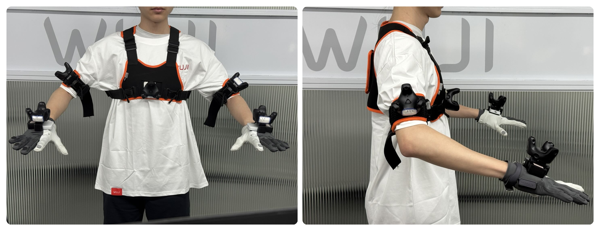

# HTC Vive Tracker wearing guide

Pair all five Trackers with SteamVR and assign their actual serial numbers under `openvr.tracker_serials` in the local `tianji_chest.yaml`. See [SteamVR setup and serial discovery](STEAMVR.md) and the [arm configuration template](../src/output_devices/tianji_output/tianji_output/config/tianji_chest.yaml.template).

| Tracker role | Mounting |
| --- | --- |
| `chest` | Secure against the chest, facing forward and parallel to the torso, with the USB-C port facing upward |
| `left_hand_back` | Secure on the back of the left MANUS glove so it follows the hand without shifting |
| `right_hand_back` | Secure on the back of the right MANUS glove so it follows the hand without shifting |
| `left_arm` | Outside of the left upper arm, facing outward, with the USB-C port along the arm bone toward the torso |
| `right_arm` | Outside of the right upper arm, facing outward, with the USB-C port along the arm bone toward the torso |

Keep all mounts stable after calibration and keep each Tracker visible to at least one base station. The system estimates each human palm from the glove-mounted hand-back Tracker using a measured mounting offset. A shifted mount changes that estimate. Upper-arm Trackers supply orientation for the IK reference direction; their positions are unused.

Configure the robot's flange-to-palm TCP transforms in `driver.tool_transforms.left/right`; both supplied transforms use identity rotation and `[0, 0, 70]` mm translation. The TCP is the robot palm, not a fingertip. Separately, measure the displacement from each human palm to its Tracker origin and enter it in `hand_back_to_palm.left/right.tracker_offset_m` in the selected profile. Use aligned human palm axes and metres: the supplied left offset is `[0, -0.05, 0]` and the right offset is `[0, 0.05, 0]`. These 50 mm offsets belong to the glove mounts, not the robot flange transforms.

Then [capture the neutral-pose calibration](STEAMVR.md#neutral-pose-calibration) against the configured arm Home. The fit aligns hand orientation before applying the offsets and fitting chest alignment to the robot palm Home poses. A static capture cannot determine the mounting distance; it uses the offsets you measured. The canonical result is `src/input_devices/openvr_input/calibration/tracker.yaml`, selected by `openvr.calibration_file`. Restart teleoperation after calibration. Repeat calibration when mounting, tool geometry, or Home changes, updating the measured offsets when needed.

During capture, stand upright, hold the arms symmetrically with elbows bent and palms down, and follow the countdown. During operation, maintain a stable torso and move slowly when adjusting posture.
